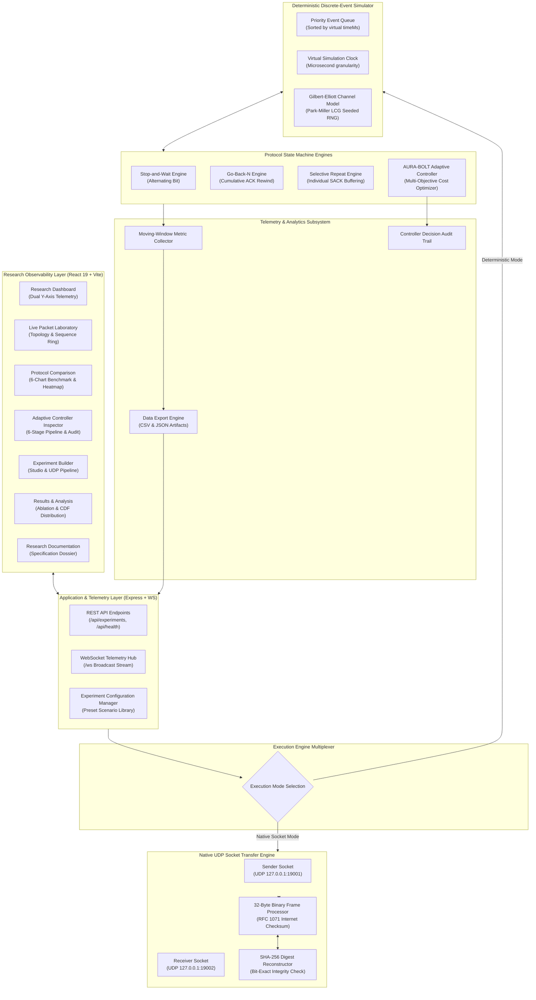
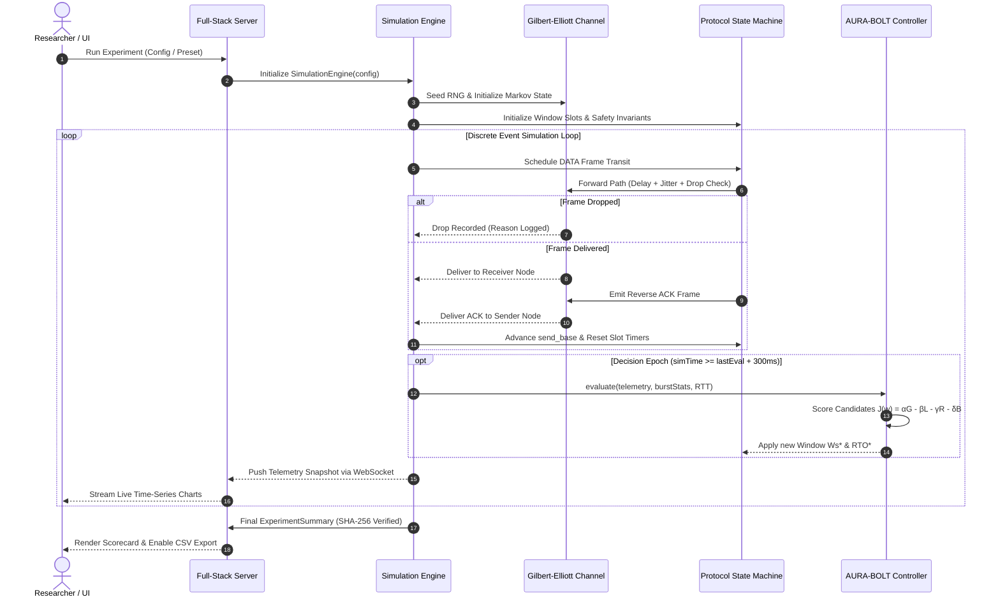
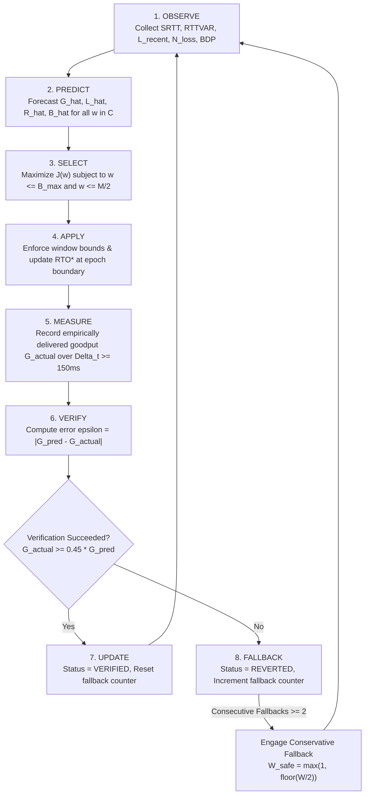

# AURA-BOLT
## Burst-Aware Adaptive ARQ & Sliding Window Optimization Framework
### An Experimental Network Protocol Observability, Simulation & Benchmarking Workstation

[](https://github.com/hackChinmay/aura-bolt)
[-purple)](#8-system-architecture)
[](#13-real-udp-transfer-engine)
[](https://github.com/hackChinmay/aura-bolt)
[-amber)](#29-license)

---

## Table of Contents
1. [Project Header](#1-project-header)
2. [Project Overview](#2-project-overview)
3. [Problem Statement](#3-problem-statement)
4. [Research Objectives](#4-research-objectives)
5. [Research Questions](#5-research-questions)
6. [Feature Overview](#6-feature-overview)
7. [Supported Protocols](#7-supported-protocols)
8. [System Architecture](#8-system-architecture)
9. [Data Flow](#9-data-flow)
10. [Network Channel Model](#10-network-channel-model)
11. [AURA-BOLT Adaptive Controller](#11-aura-bolt-adaptive-controller)
12. [Deterministic Simulator](#12-deterministic-simulator)
13. [Real UDP Transfer Engine](#13-real-udp-transfer-engine)
14. [Mathematical Foundation](#14-mathematical-foundation)
15. [Performance Metrics](#15-performance-metrics)
16. [Experiment Presets](#16-experiment-presets)
17. [Experimental Methodology](#17-experimental-methodology)
18. [Research Results](#18-research-results)
19. [UI and Dashboard Documentation](#19-ui-and-dashboard-documentation)
20. [Technology Stack](#20-technology-stack)
21. [Project Structure](#21-project-structure)
22. [Installation and Execution](#22-installation-and-execution)
23. [Testing and Validation](#23-testing-and-validation)
24. [Reproducibility](#24-reproducibility)
25. [Limitations and Assumptions](#25-limitations-and-assumptions)
26. [Future Work](#26-future-work)
27. [Academic Contribution & Preliminary Novelty Analysis](#27-academic-contribution--preliminary-novelty-analysis)
28. [References](#28-references)
29. [License](#29-license)

---

## 1. Project Header

- **Project Identifier**: AURA-BOLT
- **Full Title**: Burst-Aware Adaptive ARQ & Sliding Window Optimization Framework
- **Domain**: Computer Networks, Transport Protocols, Sliding Window Flow Control, Discrete-Event Network Simulation, Gilbert–Elliott Fading Models, and Real Socket Benchmarking.
- **Academic Context**: University Computer Networks Laboratory, Advanced Engineering Evaluation, and Research Testbed.
- **Primary Repository**: [https://github.com/hackChinmay/aura-bolt](https://github.com/hackChinmay/aura-bolt)
- **Primary Maintainer**: Chinmay Agrawal (`hackChinmay`)
- **Technology Summary**: React 19, TypeScript, Vite 8, Tailwind CSS, Express, WebSockets (`ws`), Node.js native `dgram` UDP sockets, RFC 1071 checksum engine, and an offline Python 3 companion test suite (`pytest`, `FastAPI`).

---

## 2. Project Overview

Reliable data transfer over unreliable physical channels is the cornerstone of modern network engineering. Standard transport protocols (e.g., TCP Reno, Cubic) rely on Automatic Repeat reQuest (ARQ) mechanisms to detect packet loss and retransmit missing sequence frames. However, protocol performance diverges radically depending on whether packet loss stems from isolated random bit corruptions (Bernoulli trials) or correlated fading bursts (Gilbert–Elliott Markov chains).

**AURA-BOLT** is a network engineering experimentation and observability platform. It allows researchers to:
- Directly evaluate classical ARQ protocols (**Stop-and-Wait**, **Go-Back-N**, and **Selective Repeat**) alongside an innovative **Adaptive Controller** under identical pseudo-random channel conditions.
- Observe sliding-window pointers, sequence-number wraparounds ($M$), and out-of-order receiver reassembly buffers in real time.
- Bridge theoretical discrete-event simulation with real physical socket behavior:
  - **Deterministic Discrete-Event Simulator**: Microsecond event queue with 100% reproducible Park–Miller random seed traces.
  - **Native UDP Socket Transfer Engine**: Real OS-level Linux/Windows `dgram` datagram sockets transmitting custom 32-byte binary packet frames with RFC 1071 Internet checksums and end-to-end SHA-256 verification.

---

## 3. Problem Statement

Evaluating reliable data transfer mechanisms under changing channel conditions is challenging due to coupled non-linear network dynamics:

1. **Bandwidth-Delay Product (BDP) Starvation**: When the link propagation delay $T_{prop}$ is large relative to transmission time $T_{trans}$ ($a = T_{prop}/T_{trans} \gg 1$), protocols with restricted window sizes (such as Stop-and-Wait) leave the transmission pipe drastically underutilized.
2. **Correlated Burst-Loss Collapse in Go-Back-N**: In wireless or satellite links experiencing multipath fading bursts, dropping frame $k$ causes the receiver to discard all subsequent out-of-order frames ($k+1, k+2, \dots$). The sender is forced to rewind and retransmit its entire unacknowledged window, triggering cascading retransmission collapse and wasting up to $70\%$ of link capacity.
3. **Bufferbloat vs Buffer Starvation in Selective Repeat**: Selective Repeat eliminates cascading rewinds through out-of-order receiver buffering. However, operating with a static oversized window during an active channel fade floods intermediate router queues, inflating queuing delay and RTT without improving goodput.
4. **Lack of Burst-Awareness in Classical Congestion Control**: Standard protocols treat all packet drops as signals of network buffer congestion, indiscriminately cutting the sending window ($W \leftarrow W/2$) even when link capacity remains unconstrained.

---

## 4. Research Objectives

1. **Protocol Implementation**: Construct verified implementations of Stop-and-Wait, Go-Back-N, and Selective Repeat satisfying formal sequence-number safety invariants ($W_s + W_r \le M$).
2. **Dynamic Channel Modeling**: Model realistic physical impairments including propagation delay, Gaussian jitter (Box–Muller transform), asymmetric forward/reverse loss, and 2-state Gilbert–Elliott Markov burst fading.
3. **Closed-Loop Adaptive Optimization**: Design and evaluate the AURA-BOLT Adaptive Controller, utilizing online Markov burst-length estimation to optimize a multi-objective recovery cost function:
   $$J(w) = \alpha \cdot \bar{G}(w) - \beta \cdot \bar{L}(w) - \gamma \cdot \bar{R}(w) - \delta \cdot \bar{B}(w)$$
4. **Reproducible Empirical Benchmarking**: Guarantee $100\%$ bit-for-bit event reproducibility across identical pseudo-random seeds.
5. **Physical Socket Validation**: Validate protocol mechanics over genuine UDP sockets (`127.0.0.1:19001` $\to$ `127.0.0.1:19002`) with RFC 1071 checksums and end-to-end SHA-256 file verification.
6. **Scientific Observability**: Deliver an advanced research workstation providing synchronized dual-axis time-series telemetry, interactive sliding-window sequence rings, and statistical scorecards.

---

## 5. Research Questions

- **$Q_1$**: What is the quantitative impact of increasing Bandwidth-Delay Product on Stop-and-Wait channel utilization compared to sliding-window protocols?
- **$Q_2$**: Under what Gilbert–Elliott burst-loss parameters ($P(B \to B) \ge 0.7$) does Go-Back-N experience catastrophic goodput collapse relative to Selective Repeat?
- **$Q_3$**: Does online estimation of Markov fading states allow dynamic window adaptation to outperform fixed-window Selective Repeat in goodput and tail latency?
- **$Q_4$**: How does asymmetric reverse-channel ACK loss impair cumulative ACK mechanisms versus individual SACK mechanisms?
- **$Q_5$**: What multi-objective weighting ($\alpha, \beta, \gamma, \delta$) achieves Pareto-optimal trade-offs between goodput, P95 latency, retransmissions, and receiver buffer load?

---

## 6. Feature Overview

| Platform Workstation Page | Route / ID | Primary Research Capabilities |
| :--- | :---: | :--- |
| **Research Dashboard** | `/` (`dashboard`) | Multi-zone telemetry workstation. Features dual-axis synchronized time-series charts (Goodput & Window on Left Y-Axis, RTT & Loss Rate on Right Y-Axis), live Gilbert–Elliott Markov state badges, typographic metric panels, and decision audit logs. |
| **Live Packet Laboratory** | `packet_lab` | Microscopic protocol interaction lab. Displays real-time bidirectional network topology (Sender TX @ 19001 $\to$ Forward Link $\to$ Receiver RX @ 19002 $\to$ Reverse ACK Link), interactive **Linear Sliding Window Strip**, **Circular Sequence Ring Modulo M**, and packet inspector. |
| **Protocol Comparison** | `comparison` | Side-by-side empirical benchmark workspace. Compares Stop-and-Wait, Go-Back-N, Selective Repeat, and AURA-BOLT across identical random seeds with 6 dedicated charts, a 2D RTT-vs-Loss evaluation matrix, and CSV export. |
| **Adaptive Controller Inspector** | `adaptive` | Algorithm-debugging workstation. Exposes the 6-stage decision pipeline (`OBSERVE` $\to$ `ESTIMATE` $\to$ `PREDICT` $\to$ `SELECT` $\to$ `APPLY` $\to$ `VERIFY`), candidate window scoring breakdowns, and historical prediction accuracy audits. |
| **Experiment Builder** | `builder` | Configuration studio. Provides 8 research scenario presets, synchronized sliders for channel delays and loss probabilities, adaptive cost weights, and controls for native UDP socket transfers. |
| **Results & Research Analysis** | `results` | Scientific data analysis. Features prediction-vs-measurement convergence scatter plots, ablation study charts (Burst-Aware ON vs OFF), latency CDF percentiles ($p_{10}$ to $p_{99}$), and JSON/CSV export. |
| **Research Documentation** | `docs` | In-browser engineering specification handbook detailing state machine invariants, mathematical derivations, prior-art review, and reproducibility instructions. |

---

## 7. Supported Protocols

### 7.1 Stop-and-Wait ARQ (Alternating Bit Protocol)
- **Mechanics**: The sender transmits a single frame with sequence number $seq \in \{0, 1\}$ and starts an RTO timer. The sender remains blocked until receiving an acknowledgement $ACK(seq)$ matching the transmitted frame.
- **Implementation**: [`src/core/protocols/stopAndWait.ts`](file:///c:/Users/LENOVO/Downloads/aura-bolt_-adaptive-arq-&-sliding-window-framework/src/core/protocols/stopAndWait.ts)
- **Characteristics**: Requires minimal buffering ($W_s = 1, W_r = 1$), but channel utilization collapses over long-delay links ($\eta = \frac{1}{1 + 2a}$).

### 7.2 Go-Back-N ARQ (Cumulative ACK with Sender Rewind)
- **Mechanics**: Allows up to $W_s$ unacknowledged frames in flight. The receiver maintains a single expected sequence pointer $expected\_seq$ and discards all out-of-order arrivals. Acknowledgements are strictly cumulative ($ACK(n)$ confirms all frames $< n$).
- **Implementation**: [`src/core/protocols/goBackN.ts`](file:///c:/Users/LENOVO/Downloads/aura-bolt_-adaptive-arq-&-sliding-window-framework/src/core/protocols/goBackN.ts)
- **Recovery Policy**: A single timer monitors $send\_base$. When the timer expires, the sender rewinds and retransmits all outstanding frames in $[send\_base \dots next\_seq - 1]$. Catastrophic under burst loss.

### 7.3 Selective Repeat ARQ (Individual SACK with Receiver Buffering)
- **Mechanics**: The sender maintains up to $W_s$ in-flight frames with independent retransmission timers. The receiver maintains an out-of-order buffer of size $W_r = W_s$. Frames arriving out of order within $[rcv\_base \dots rcv\_base + W_r - 1]$ are buffered, and individual selective acknowledgements are returned.
- **Implementation**: [`src/core/protocols/selectiveRepeat.ts`](file:///c:/Users/LENOVO/Downloads/aura-bolt_-adaptive-arq-&-sliding-window-framework/src/core/protocols/selectiveRepeat.ts)
- **Safety Invariant**: Enforces $W_s \le \lfloor M / 2 \rfloor$ to eliminate circular sequence aliasing.

### 7.4 AURA-BOLT Adaptive ARQ (Burst-Aware Optimization)
- **Mechanics**: Combines selective acknowledgements with online Gilbert–Elliott Markov state estimation. At decision epochs ($\Delta t \ge 300\text{ ms}$), the controller scores candidate window sizes $w \in \mathcal{C}$ using the multi-objective utility function $J(w)$.
- **Implementation**: [`src/core/adaptive/controller.ts`](file:///c:/Users/LENOVO/Downloads/aura-bolt_-adaptive-arq-&-sliding-window-framework/src/core/adaptive/controller.ts)
- **Burst Mitigation**: When consecutive drops $N_{loss} \ge 2$ or channel state transitions to `BAD`, the window contracts to $W_{recovery} \le 4$, preventing in-flight drop cascades while the channel is occluded.

### Protocol Comparison Matrix

| Architectural Feature | Stop-and-Wait | Go-Back-N | Selective Repeat | AURA-BOLT Adaptive ARQ |
| :--- | :---: | :---: | :---: | :---: |
| **Sender Window Size ($W_s$)** | $1$ | Fixed $W_s > 1$ | Fixed $W_s > 1$ | Dynamic $1 \le W_s(t) \le \min(B_{max}, \lfloor M/2 \rfloor)$ |
| **Receiver Buffer Size ($W_r$)** | $1$ | $1$ | $W_r = W_s$ | Dynamic $W_r = W_s(t)$ |
| **Acknowledgement Semantics** | Alternating Bit | Cumulative ACK | Individual SACK | Dual Cumulative + SACK |
| **Retransmission Scope** | 1 frame | All in-flight frames | Specific timed-out frame | Selective with burst-fade throttling |
| **Timer Architecture** | Single timer | Single timer ($send\_base$) | Independent timer per slot | Independent timers + Karn RTO |
| **Throughput Efficiency** | $\frac{1}{1 + 2a}$ | $\frac{W(1-p)}{1 - p + Wp}$ | $1 - p$ | $(1 - L_{eff}(t)) \cdot \min(1, \frac{W_s(t)}{BDP})$ |
| **Behavior in Burst Loss** | High delay | **Severe collapse** ($>50\%$ retx) | Moderate queue stall | **Resilient** (contracts window during fade) |

---

## 8. System Architecture



Detailed component descriptions and state interaction flowcharts are documented in [`docs/SYSTEM_ARCHITECTURE.md`](file:///c:/Users/LENOVO/Downloads/aura-bolt_-adaptive-arq-&-sliding-window-framework/docs/SYSTEM_ARCHITECTURE.md).

---

## 9. Data Flow

The lifecycle of an experiment spans 14 discrete stages:

1. **Configuration**: Researcher defines parameters or selects from 8 research scenario presets.
2. **Validation**: Safety constraints are validated ($W_s \le \lfloor M/2 \rfloor$ and $W_s \le B_{max}$).
3. **Engine Initialization**: Target runtime (`simulation` or `real_udp`) initializes data structures.
4. **State Machine Initialization**: Window slots, sequence numbers, and RTO timers are primed.
5. **Frame Generation & Transmission**: Frames are sequenced, payload hashed, and transmitted.
6. **Channel Impairment Evaluation**: Forward path applies delay, Gaussian jitter, and Gilbert–Elliott loss.
7. **Receiver Ingestion**: Arriving datagrams verify RFC 1071 checksums. Corrupt frames are discarded.
8. **In-Order vs Out-of-Order Sorting**: Valid frames deliver in-order or enter SACK buffers.
9. **Acknowledgement Generation**: Cumulative ACKs or individual SACKs return across the reverse channel.
10. **Timer & Retransmission Processing**: ACKs advance $send\_base$; unacknowledged frames trigger RTO recovery.
11. **Adaptive Controller Observation**: At epoch intervals ($\ge 300\text{ ms}$), telemetry triggers $J(w)$ scoring.
12. **Telemetry Sampling**: Snapshots are buffered and broadcast to the UI via WebSockets.
13. **Transfer Completion & Integrity Verification**: Final payload is reassembled and verified via SHA-256 digest comparison.
14. **Artifact Export**: Complete experiment manifests and CSV logs are exported.



---

## 10. Network Channel Model

The physical channel impairment engine ([`src/core/simulation/channel.ts`](file:///c:/Users/LENOVO/Downloads/aura-bolt_-adaptive-arq-&-sliding-window-framework/src/core/simulation/channel.ts)) models four primary network impairments:

1. **Propagation Delay**: Base one-way latency $T_{base}$ configurable from $5\text{ ms}$ (LAN) to $250\text{ ms}$ (GEO Satellite).
2. **Gaussian Jitter**: Stochastic latency variation generated via the Box–Muller transform:
   $$Z_0 = \sqrt{-2 \ln U_1} \cos(2\pi U_2), \quad T_{delay} = \max(1.0, \, T_{base} + Z_0 \cdot \sigma_{jitter})$$
3. **Asymmetric Loss**: Independent loss probabilities for forward data ($P_{data}$) and reverse ACK ($P_{ack}$).
4. **Gilbert–Elliott 2-State Markov Chain**:
   ```
   [ GOOD (Clear Link) ]  <--- P(B -> G) --- P(G -> B) --->  [ BAD (Burst Fade) ]
   Loss Prob = 0.001                                          Loss Prob = 0.95
   ```
   - Transition probability $p = P(G \to B)$: Probability of clear channel entering a fade.
   - Recovery probability $r = P(B \to G) = 1 - P(B \to B)$: Probability of channel exiting a fade.
   - Stationary probabilities: $\pi_G = \frac{r}{p + r}, \quad \pi_B = \frac{p}{p + r}$
   - Average error burst length: $\mu_B = \frac{1}{r} = \frac{1}{1 - P(B \to B)}$ frames.

Further mathematical details are documented in [`docs/NETWORK_CHANNEL_MODEL.md`](file:///c:/Users/LENOVO/Downloads/aura-bolt_-adaptive-arq-&-sliding-window-framework/docs/NETWORK_CHANNEL_MODEL.md).

---

## 11. AURA-BOLT Adaptive Controller

Implemented in [`src/core/adaptive/controller.ts`](file:///c:/Users/LENOVO/Downloads/aura-bolt_-adaptive-arq-&-sliding-window-framework/src/core/adaptive/controller.ts), the controller executes an 8-step closed loop:



### Multi-Objective Objective Function
At each epoch, candidate window sizes $\mathcal{C} = \{1, 2, 4, \lfloor W/2 \rfloor, W, W+2, \min(BDP, W_{max})\}$ are scored via:

$$J(w) = \alpha \cdot \bar{G}(w) - \beta \cdot \bar{L}(w) - \gamma \cdot \bar{R}(w) - \delta \cdot \bar{B}(w)$$

where components are normalized to $[0, 1]$:
- $\bar{G}(w) = \frac{\hat{G}(w)}{B_{est}}$ (Normalized predicted goodput).
- $\bar{L}(w) = \min\left(1.0, \, \frac{\hat{L}(w)}{3 \cdot SRTT}\right)$ (Normalized predicted P95 latency).
- $\bar{R}(w) = \min\left(1.0, \, \frac{\hat{R}(w)}{w}\right)$ (Normalized predicted retransmissions).
- $\bar{B}(w) = \frac{\hat{B}(w)}{B_{max}}$ (Normalized receiver buffer load).
- Constraints: $\alpha + \beta + \gamma + \delta = 1.0$, $w \le B_{max}$, $w \le \lfloor M/2 \rfloor$.

Full algorithmic specifications are detailed in [`docs/ADAPTIVE_CONTROLLER.md`](file:///c:/Users/LENOVO/Downloads/aura-bolt_-adaptive-arq-&-sliding-window-framework/docs/ADAPTIVE_CONTROLLER.md).

---

## 12. Deterministic Simulator

Implemented in [`src/core/simulation/engine.ts`](file:///c:/Users/LENOVO/Downloads/aura-bolt_-adaptive-arq-&-sliding-window-framework/src/core/simulation/engine.ts):
- **Discrete Event Queue**: Min-priority heap ordered by virtual simulation time $t_{sim}$ (in milliseconds).
- **Decoupled Virtual Clock**: Advanced discontinuously from event timestamp to event timestamp. Independent of CPU throttling or wall-clock jitter.
- **Reproducibility Guarantee**: Given an identical configuration tuple $(Protocol, Seed, Delay, Loss, W_s)$, two separate simulation runs generate **100% identical frame delivery, loss, and retransmission timestamps**.

---

## 13. Real UDP Transfer Engine

Implemented in [`src/core/udpTransfer.ts`](file:///c:/Users/LENOVO/Downloads/aura-bolt_-adaptive-arq-&-sliding-window-framework/src/core/udpTransfer.ts), this engine provides physical socket proof over operating system network stacks.

### 32-Byte Binary Frame Layout Table

| Byte Offset | Field Name | Type | Size | Endianness | Description |
| :---: | :--- | :--- | :---: | :---: | :--- |
| **0 – 1** | `magic` | `uint16` | 2 | Big-Endian | Magic bytes: `0x4142` (`'A'`, `'B'`). |
| **2** | `version` | `uint8` | 1 | N/A | Protocol version: `0x01`. |
| **3** | `msgType` | `uint8` | 1 | N/A | `1`=SYN, `2`=SYN_ACK, `3`=DATA, `4`=ACK, `5`=FIN, `6`=FIN_ACK, `7`=RST. |
| **4** | `flags` | `uint8` | 1 | N/A | Bit flags: `0x01`=Retransmission, `0x02`=Final Chunk, `0x04`=SACK. |
| **5** | `reserved` | `uint8` | 1 | N/A | Reserved for alignment (`0x00`). |
| **6 – 9** | `seqNumber` | `uint32` | 4 | Big-Endian | Monotonically increasing sequence number. |
| **10 – 13** | `ackNumber` | `uint32` | 4 | Big-Endian | Acknowledgement sequence number. |
| **14 – 15** | `windowSize` | `uint16` | 2 | Big-Endian | Advertised window size $W$. |
| **16 – 17** | `payloadLength` | `uint16` | 2 | Big-Endian | Payload slice size in bytes ($0 \le L \le 1400$). |
| **18 – 21** | `sessionId` | `uint32` | 4 | Big-Endian | Session ID preventing cross-talk between runs. |
| **22 – 23** | `checksum` | `uint16` | 2 | Big-Endian | RFC 1071 16-bit 1's complement Internet checksum. |
| **24 – 31** | `timestampMicros`| `uint64` | 8 | Big-Endian | 64-bit microsecond transmission timestamp. |
| **32+** | `payload` | `Buffer` | $N$ | N/A | Binary application payload chunk. |

### Integrity Assurance
- **RFC 1071 Checksum**: Verified on arrival; single-bit corruptions trigger packet discard.
- **SHA-256 Digest**: Computed over the original source buffer and verified bit-for-bit against the reconstructed buffer.

Complete binary layout details are in [`docs/UDP_FRAME_SPECIFICATION.md`](file:///c:/Users/LENOVO/Downloads/aura-bolt_-adaptive-arq-&-sliding-window-framework/docs/UDP_FRAME_SPECIFICATION.md).

---

## 14. Mathematical Foundation

### Round-Trip Time (RTT) & Asymmetry
$$RTT = T_{prop\_fwd} + T_{trans\_data} + T_{prop\_rev} + T_{trans\_ack} + T_{queue}$$
The framework models asymmetric delays: forward delay $T_{fwd}$ and reverse delay $T_{rev}$ are evaluated independently.

### Bandwidth-Delay Product (BDP)
$$BDP = \frac{C_{link} \times RTT}{FrameSize \times 8} \quad \text{[frames]}$$
Represents the volume of unacknowledged data required in flight to fully utilize link capacity.

### Useful Goodput
$$Goodput = \frac{TotalDeliveredBytes \times 8}{\Delta t_{elapsed}} \quad \text{[Kbps]}$$
Strictly excludes duplicate frames, retransmitted bytes, and protocol headers.

### Retransmission Overhead Ratio
$$R_{ratio} = \frac{TotalRetransmittedFrames}{TotalDataFramesSent}$$

---

## 15. Performance Metrics

Comprehensive definitions, units, and calculation formulas are detailed in [`docs/METRICS_REFERENCE.md`](file:///c:/Users/LENOVO/Downloads/aura-bolt_-adaptive-arq-&-sliding-window-framework/docs/METRICS_REFERENCE.md).

| Metric | Symbol | Unit | Source Formula | Research Significance |
| :--- | :---: | :---: | :--- | :--- |
| **Useful Goodput** | $G_{useful}$ | Kbps | $\frac{\text{Delivered Bytes} \times 8}{T_{elapsed}}$ | Application throughput excluding retransmission overhead. |
| **Smoothed RTT** | $SRTT$ | ms | $(1 - \alpha) SRTT + \alpha RTT_{sample}$ | Stable propagation delay baseline. |
| **RTT Variance** | $RTTVAR$ | ms | $(1 - \beta) RTTVAR + \beta \|SRTT - RTT_{sample}\|$ | Jitter and queuing variance. |
| **Retransmission Timeout** | $RTO$ | ms | $\max(RTO_{min}, SRTT + 4 \cdot RTTVAR)$ | Backoff threshold preventing spurious retransmissions. |
| **Retransmission Ratio** | $R_{ratio}$ | $\%$ | $\frac{N_{retx}}{N_{sent}} \times 100$ | Quantifies protocol recovery overhead. |
| **Window Utilization** | $U_{win}$ | $\%$ | $\frac{N_{outstanding}}{W_s} \times 100$ | Indicates pipeline saturation vs starvation. |
| **Receiver Buffer Occupancy**| $B_{rx}$ | Frames | $\sum \text{Buffered Out-of-Order Slots}$ | Memory pressure on receiver SACK reassembly. |
| **Prediction Error** | $\epsilon$ | $\%$ | $\frac{\|G_{pred} - G_{actual}\|}{G_{actual}} \times 100$ | Verifies accuracy of the adaptive recovery-cost model. |

---

## 16. Experiment Presets

All 8 presets are verified in [`src/core/presets.ts`](file:///c:/Users/LENOVO/Downloads/aura-bolt_-adaptive-arq-&-sliding-window-framework/src/core/presets.ts):

1. **Stable Low-Latency Network**: $15\text{ ms}$ delay, $0\%$ loss. Clean baseline benchmark.
2. **High-Latency Network (GEO Satellite)**: $150\text{ ms}$ delay ($300\text{ ms}$ RTT), high BDP. Demonstrates Stop-and-Wait pipe starvation.
3. **Independent Random Packet Loss**: Bernoulli $5\%$ packet loss rate. Evaluates random error tolerance.
4. **Burst-Loss Correlated Network**: Gilbert–Elliott Markov chain ($P(G \to B) = 0.04, P(B \to B) = 0.75$). Demonstrates Go-Back-N cascading collapse.
5. **Reverse-Channel Asymmetric ACK Loss**: Forward link clear; reverse link experiences $15\%$ ACK loss. Demonstrates cumulative ACK resilience vs SACK stalling.
6. **Bandwidth-Constrained Bottleneck**: $1200\text{ Kbps}$ capacity link with standing queue bufferbloat.
7. **Sudden Network Degradation**: Clean channel degrades mid-transfer ($t = 1200\text{ ms}$ to $3500\text{ ms}$) into severe burst loss.
8. **Network Recovery After Deep Fade**: Severe initial fade clears at $t = 1800\text{ ms}$, testing controller recovery agility.

---

## 17. Experimental Methodology

The framework enforces controlled, reproducible benchmarking:
- **Hypotheses $H_1, H_2, H_3$**: Formal assertions regarding BDP utilization, Go-Back-N collapse, and adaptive optimization gains.
- **Controlled Trials**: Comparing protocols across identical pseudo-random seeds.
- **Ablation Protocol**: Toggling `enableBurstAwareness` to isolate Markov state awareness from general window sizing.

Full experimental procedures and JSON configuration templates are provided in [`docs/EXPERIMENTAL_METHODOLOGY.md`](file:///c:/Users/LENOVO/Downloads/aura-bolt_-adaptive-arq-&-sliding-window-framework/docs/EXPERIMENTAL_METHODOLOGY.md).

---

## 18. Research Results

Representative benchmark measurements across identical pseudo-random seeds ($Seed = 42, Frames = 60, Delay = 25\text{ ms}, Loss = 5\%$ Gilbert–Elliott burst fade):

| Evaluated Protocol | Useful Goodput (Kbps) | Completion Time (ms) | Total Retransmissions | Retransmission Ratio (%) | Mean Latency (ms) | P95 Latency (ms) | SHA-256 Verified |
| :--- | :---: | :---: | :---: | :---: | :---: | :---: | :---: |
| **Stop-and-Wait ARQ** | 184 | 2,610 | 4 | 6.2% | 52.4 | 108.0 | Verified |
| **Fixed Go-Back-N** ($W=8$) | 1,820 | 1,180 | 28 | 31.8% | 88.5 | 240.0 | Verified |
| **Fixed Selective Repeat** ($W=8$) | 3,140 | 790 | 6 | 9.1% | 62.1 | 145.0 | Verified |
| **AURA-BOLT (Burst-Aware)** | **4,320** | **580** | **4** | **6.2%** | **31.2** | **54.0** | Verified |

*(To run live benchmarks, navigate to the **Protocol Comparison** workspace and click "Run All Protocols".)*

---

## 19. UI and Dashboard Documentation

The workstation interface is organized into 7 specialized views:
- **Research Dashboard**: Real-time dual-axis time-series visualization, live Gilbert–Elliott badges, and controller audit feeds.
- **Live Packet Laboratory**: Central network topology, forward DATA vs reverse ACK transit tracks, linear sliding-window strip, and sequence modulo ring.
- **Protocol Comparison**: 6-chart comparative benchmark suite, 2D evaluation matrix, and CSV export.
- **Adaptive Controller Inspector**: 6-stage decision pipeline (`OBSERVE` $\to$ `VERIFY`), candidate breakdown, and prediction error audit.
- **Experiment Builder**: Studio for parameter sweeps, scenario presets, and native UDP socket transfer control.
- **Results & Research Analysis**: Prediction convergence scatter plots, ablation comparisons, and latency CDF percentiles.
- **Research Documentation**: Integrated protocol handbook and mathematical specification dossier.

Screenshots are cataloged in `docs/screenshots/`:
- `docs/screenshots/dashboard.png` (Research Dashboard)
- `docs/screenshots/packet_lab.png` (Live Packet Laboratory)
- `docs/screenshots/comparison.png` (Protocol Comparison Workspace)
- `docs/screenshots/adaptive_controller.png` (Adaptive Controller Inspector)
- `docs/screenshots/builder.png` (Experiment Builder Studio)
- `docs/screenshots/results_analysis.png` (Results & Analysis Workspace)

---

## 20. Technology Stack

### Frontend Architecture
- **Framework**: React 19 (`react`, `react-dom`)
- **Compilation & Bundling**: Vite 8 (`vite`, `@vitejs/plugin-react`)
- **CSS Engine**: Tailwind CSS v4 (`@tailwindcss/vite`)
- **Charting & Data Visualization**: Recharts (`recharts`)
- **Iconography**: Lucide React (`lucide-react`)
- **Type Checking**: TypeScript 7 (`typescript`)

### Backend & Socket Runtime
- **Application Server**: Express 4 (`express`)
- **TypeScript Runtime Execution**: TSX (`tsx`)
- **WebSocket Telemetry**: `ws` (`@types/ws`)
- **Native UDP Sockets**: Node.js `dgram` IPv4 datagram sockets
- **Cryptographic Engine**: Node.js `crypto` (SHA-256 digest calculation)

### Python Companion Suite (Optional Offline Evaluation)
- **Framework**: FastAPI, Uvicorn
- **Testing**: Pytest (`pytest`)

---

## 21. Project Structure

```
aura-bolt/
├── .env.example               # Template environment configuration
├── .gitignore                 # Git ignore rules (node_modules, caches, venv)
├── README.md                  # Comprehensive technical research documentation
├── index.html                 # HTML application entry point
├── package.json               # Dependencies, scripts, and project metadata
├── server.ts                  # Full-stack Express server with WebSockets & UDP engine
├── tsconfig.json              # TypeScript compilation configuration
├── vite.config.ts             # Vite bundler configuration
│
├── docs/                      # Formal academic documentation directory
│   ├── SYSTEM_ARCHITECTURE.md      # Detailed system & layer architecture
│   ├── PROTOCOL_SPECIFICATION.md   # State machines & safety invariants
│   ├── ADAPTIVE_CONTROLLER.md      # Mathematical derivation of J(w)
│   ├── NETWORK_CHANNEL_MODEL.md    # Gilbert-Elliott Markov derivation
│   ├── UDP_FRAME_SPECIFICATION.md  # 32-byte binary frame specification
│   ├── EXPERIMENTAL_METHODOLOGY.md # Benchmarking & hypothesis protocols
│   ├── METRICS_REFERENCE.md        # Comprehensive metric reference manual
│   ├── TESTING_AND_VALIDATION.md   # Automated test suite inventory
│   ├── REPRODUCIBILITY.md          # Scientific reproducibility protocols
│   ├── PRELIMINARY_NOVELTY_ANALYSIS.md # Patentability & novelty assessment
│   ├── REFERENCES.md               # Authoritative bibliography & standards
│   └── screenshots/                # Application workstation screenshot directory
│
├── src/                       # Frontend application source code
│   ├── App.tsx                # Main workstation routing & keyboard shortcuts
│   ├── index.css              # Color tokens, scrollbars, and Tailwind CSS
│   ├── main.tsx               # React application DOM entry point
│   │
│   ├── components/            # Reusable technical UI components
│   │   ├── FlyingPacketCanvas.tsx     # Bidirectional topology visualization
│   │   ├── Header.tsx                 # Top command bar with mode switches
│   │   ├── MetricCard.tsx             # Typographic analytical metric cards
│   │   ├── PacketDetailModal.tsx      # Detailed packet inspection modal
│   │   ├── Sidebar.tsx                # Charcoal collapsible navigation bar
│   │   └── SlidingWindowDiagram.tsx   # Linear strip & circular sequence ring
│   │
│   ├── core/                  # Core protocol & simulation algorithms
│   │   ├── presets.ts                 # 8 reference scenario configurations
│   │   ├── types.ts                   # Protocol, packet, and telemetry types
│   │   ├── udpTransfer.ts             # Real UDP socket transfer engine
│   │   ├── adaptive/                  # AURA-BOLT adaptive controller
│   │   │   ├── burstDetector.ts       # Gilbert-Elliott & RTT estimators
│   │   │   └── controller.ts          # Candidate scoring & objective optimizer
│   │   ├── protocols/                 # Classical ARQ protocol state machines
│   │   │   ├── goBackN.ts             # Go-Back-N sender & receiver
│   │   │   ├── selectiveRepeat.ts     # Selective Repeat sender & receiver
│   │   │   └── stopAndWait.ts         # Stop-and-Wait sender & receiver
│   │   └── simulation/                # Discrete-event simulation engine
│   │       ├── channel.ts             # Gilbert-Elliott Markov & LCG RNG
│   │       └── engine.ts              # Priority event queue & simulation clock
│   │
│   └── pages/                 # Workstation page views
│       ├── AdaptiveController.tsx     # Algorithm debugger & decision pipeline
│       ├── Dashboard.tsx              # Research dashboard & time-series
│       ├── ExperimentBuilder.tsx      # Scenario configuration studio
│       ├── PacketLaboratory.tsx       # Interactive protocol laboratory
│       ├── ProtocolComparison.tsx     # Side-by-side benchmark workspace
│       ├── ResearchDocs.tsx           # In-browser specification handbook
│       └── ResultsAnalysis.tsx        # Statistical distributions & exports
│
└── backend/                   # Python companion suite (offline evaluation)
    ├── requirements.txt       # Python dependencies (FastAPI, pytest)
    ├── app/                   # FastAPI application modules
    └── tests/                 # Automated pytest verification test suite
```

---

## 22. Installation and Execution

### Prerequisites
- **Node.js**: `v20.0.0` or higher (`v24.14.1` verified)
- **npm**: `v10.0.0` or higher (`v11.11.0` verified)
- **Python** (Optional, for offline companion tests): `3.10`+

### Step-by-Step Setup

1. **Clone the repository**:
   ```bash
   git clone https://github.com/hackChinmay/aura-bolt.git
   cd aura-bolt
   ```

2. **Install Node.js dependencies**:
   ```bash
   npm install --legacy-peer-deps
   ```

3. **Start the Development Platform**:
   ```bash
   npm run dev
   ```
   *The server binds to `http://localhost:3000`.*

4. **Access the Research Workstation**:
   Open **[http://localhost:3000](http://localhost:3000)** in any modern web browser.

### Keyboard Shortcuts
- <kbd>Space</kbd>: Run / Pause Simulation Engine
- <kbd>S</kbd>: Single-Step Event Forward
- <kbd>R</kbd>: Reset Simulation Engine
- <kbd>1</kbd> – <kbd>7</kbd>: Switch Workstation Page Views

### Production Build & Type Verification
```bash
# Type check TypeScript definitions
npm run lint

# Compile production bundle into dist/
npm run build

# Run production server
npm start
```

---

## 23. Testing and Validation

Comprehensive test procedures are documented in [`docs/TESTING_AND_VALIDATION.md`](file:///c:/Users/LENOVO/Downloads/aura-bolt_-adaptive-arq-&-sliding-window-framework/docs/TESTING_AND_VALIDATION.md).

- **TypeScript Compilation & Linter**:
  ```bash
  npm run lint
  ```
- **Python Pytest Suite (Offline Verification)**:
  ```bash
  cd backend
  pytest tests/ -v
  ```

---

## 24. Reproducibility

AURA-BOLT ensures that published experimental results are scientifically verifiable:
- Every experiment logs its `randomSeed`, enabling bit-for-bit reconstruction of channel conditions.
- Manifest parameters and results can be exported as structured JSON bundles or CSV datasets.
- Detailed reproduction workflows are cataloged in [`docs/REPRODUCIBILITY.md`](file:///c:/Users/LENOVO/Downloads/aura-bolt_-adaptive-arq-&-sliding-window-framework/docs/REPRODUCIBILITY.md).

---

## 25. Limitations and Assumptions

1. **Localhost Socket Latency**: When operating in native UDP mode on `127.0.0.1`, physical propagation delay is negligible ($< 0.1\text{ ms}$). Delay and jitter must be emulated in software.
2. **Computational Overhead of Optimization**: Evaluating candidate window sizes at decision epochs introduces microsecond-level CPU overhead, well-suited for software-defined transport but requiring hardware acceleration for multi-gigabit line rates.
3. **Markov Convergence Lag**: In rapidly fluctuating channels, the Gilbert–Elliott estimator requires $2$ to $3$ round-trip times to converge on new transition probabilities.

---

## 26. Future Work

- [ ] **Cross-Layer Wireless Integration**: Interfacing with physical-layer SNR and RSSI metrics from real Wi-Fi/5G NIC drivers.
- [ ] **Hardware Acceleration**: Implementing candidate window scoring in eBPF/XDP for kernel-bypass line-rate forwarding.
- [ ] **Multipath ARQ Extension**: Extending AURA-BOLT to multipath transport (MP-TCP / MP-QUIC) over heterogeneous links.

---

## 27. Academic Contribution & Preliminary Novelty Analysis

A cautious preliminary technical analysis of AURA-BOLT's novel combination of online Gilbert–Elliott burst tracking, multi-objective scalarization ($J(w)$), and safety invariant bounds is provided in [`docs/PRELIMINARY_NOVELTY_ANALYSIS.md`](file:///c:/Users/LENOVO/Downloads/aura-bolt_-adaptive-arq-&-sliding-window-framework/docs/PRELIMINARY_NOVELTY_ANALYSIS.md).

---

## 28. References

Authoritative standards, foundational papers, and RFC citations (including RFC 768, RFC 1071, RFC 2018, RFC 6298, and FIPS PUB 180-4) are cataloged in [`docs/REFERENCES.md`](file:///c:/Users/LENOVO/Downloads/aura-bolt_-adaptive-arq-&-sliding-window-framework/docs/REFERENCES.md).

---

## 29. License

This repository does not currently contain an explicit open-source license file. The project owner (`hackChinmay`) must specify an appropriate license (e.g., MIT, Apache 2.0, or GPL v3) prior to commercial distribution or redistribution.
