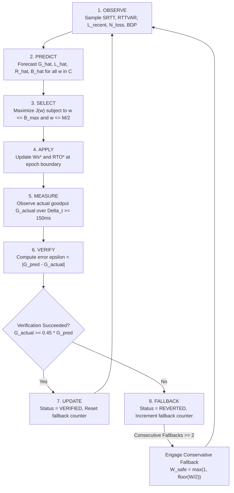

# AURA-BOLT Adaptive Controller Specification

## 1. Architectural Philosophy

Standard transport-layer adaptation algorithms (e.g. TCP Reno, Cubic) rely on simplistic loss-based heuristics: every observed packet drop is interpreted as buffer overflow due to network congestion, triggering an immediate multiplicative window collapse ($W \leftarrow W/2$). 

In dynamic channels featuring wireless multipath fading, high propagation delays, or asymmetric reverse paths, losses are predominantly **correlated fading bursts** rather than persistent buffer exhaustion. Halving the window during an isolated random drop starves high-capacity pipes, while maintaining a large window during a correlated burst floods the channel and triggers cascading retransmissions.

**AURA-BOLT** introduces a closed-loop multi-objective recovery cost optimizer that explicitly tracks Gilbert–Elliott Markov burst transitions and dynamically evaluates candidate window sizes.

---

## 2. 8-Step Closed-Loop Control Lifecycle

---

## 3. Mathematical Optimization Model

### 3.1 Candidate Window Space
At each evaluation epoch ($\Delta t \ge 300\text{ ms}$), the controller generates a discrete candidate set $\mathcal{C}$ spanning conservative recovery to pipe-saturating bounds:

$$\mathcal{C} = \left\{ 1, \, 2, \, 4, \, \left\lfloor \frac{W_{current}}{2} \right\rfloor, \, W_{current}, \, \min(W_{max}, W_{current} + 2), \, \min(W_{max}, \max(1, BDP)), \, W_{max} \right\}$$

Every candidate $w \in \mathcal{C}$ is tested against physical feasibility constraints:
1. **Receiver Buffer Constraint**: $w \le B_{max}$
2. **Sequence Modulus Invariant**: $w \le \lfloor M / 2 \rfloor$

### 3.2 Predictive Metric Models
For each candidate window $w$, four projected performance components are computed:

#### A. Predicted Useful Goodput ($\hat{G}(w)$ in Kbps)
$$\hat{G}(w) = B_{est} \cdot \min\left(1.0, \, \frac{w}{BDP}\right) \cdot (1 - L_{eff})$$
where $L_{eff}$ accounts for burst clustering:
$$L_{eff} = \min\left(0.9, \, L_{recent} \cdot \left(1.0 + \mu_{burst} \cdot 0.4\right)\right) \quad \text{if channel is } \text{BAD}$$

#### B. Predicted P95 Latency ($\hat{L}(w)$ in ms)
$$\hat{L}(w) = SRTT + \max(0, \, (w - BDP) \cdot 8) + L_{eff} \cdot (SRTT + 2 \cdot RTTVAR)$$
The first term represents propagation delay, the second models bufferbloat queuing delay when window exceeds BDP, and the third captures RTO retransmission penalty.

#### C. Predicted Retransmission Overhead ($\hat{R}(w)$ in frames/RTT)
$$\hat{R}(w) = w \cdot L_{eff}$$

#### D. Predicted Receiver Buffer Usage ($\hat{B}(w)$ in frames)
$$\hat{B}(w) = \min\left(B_{max}, \, \mathrm{round}\left(w \cdot (0.3 + L_{eff} \cdot 0.7)\right)\right)$$

### 3.3 Normalized Multi-Objective Utility Function
To permit dimensional scalarization, each component is normalized to $[0, 1]$:

$$\bar{G}(w) = \frac{\hat{G}(w)}{\max(1, B_{est})}$$

$$\bar{L}(w) = \min\left(1.0, \, \frac{\hat{L}(w)}{\max(10, \, 3 \cdot SRTT)}\right)$$

$$\bar{R}(w) = \min\left(1.0, \, \frac{\hat{R}(w)}{\max(1, w)}\right)$$

$$\bar{B}(w) = \frac{\hat{B}(w)}{B_{max}}$$

The composite objective score $J(w)$ is evaluated as:

$$J(w) = \alpha \cdot \bar{G}(w) - \beta \cdot \bar{L}(w) - \gamma \cdot \bar{R}(w) - \delta \cdot \bar{B}(w)$$

where:
- $\alpha$: Goodput maximization weight (default: $0.45$)
- $\beta$: Latency minimization weight (default: $0.25$)
- $\gamma$: Retransmission penalty weight (default: $0.20$)
- $\delta$: Buffer occupancy constraint weight (default: $0.10$)
- Invariant: $\alpha + \beta + \gamma + \delta = 1.0$

### 3.4 Selection Policy
The optimal candidate window is selected via:

$$w^* = \arg\max_{w \in \mathcal{C}, \, w \text{ feasible}} J(w)$$

---

## 4. Operational Control Modes

| Control Mode | Activation Condition | Controller Action | Research Significance |
| :--- | :--- | :--- | :--- |
| **`OPTIMAL`** | Steady-state channel; $w^* == W_{current}$ | Maintain current window $W_s$ | Preserves maximum link efficiency without inducing artificial jitter |
| **`PROBING`** | Channel clear ($S = \text{GOOD}$), $w^* > W_{current}$ | Increment window $W_s \leftarrow w^*$ | Expands pipeline toward full Bandwidth-Delay Product |
| **`CONSERVATIVE_RECOVERY`** | Burst fade ($S = \text{BAD}$) or consecutive drops $\ge 2$ | Contract window $W_s \leftarrow \max(1, \min(4, \lfloor W/2 \rfloor))$ | Curtails in-flight frames to eliminate packet drops during active burst |
| **`FALLBACK`** | $\ge 2$ consecutive verification failures | Enforce safe baseline $W_s \leftarrow \max(1, \lfloor W/2 \rfloor)$ | Emergency safeguard against estimation instability or sudden channel divergence |
