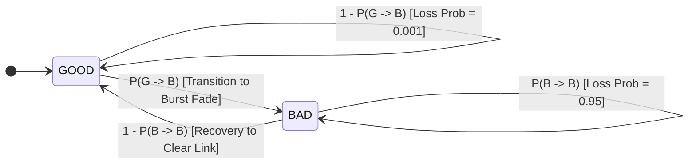

# AURA-BOLT Network Channel Impairment Model

## 1. Impairment Subsystem Overview

In physical networks, packet loss and latency variations are rarely independent or identically distributed (i.i.d.). Wireless channels, terrestrial cellular backhauls, and low Earth orbit (LEO) satellite links suffer from multipath fading, shadow fading, and bufferbloat-induced queuing delays.

**AURA-BOLT** incorporates a comprehensive channel impairment engine (`src/core/simulation/channel.ts`) implementing four distinct impairment primitives:
1. **Propagation Delay & Asymmetric RTT**.
2. **Stochastic Gaussian Jitter via Box–Muller Transform**.
3. **Gilbert–Elliott 2-State Markov Burst Loss Model**.
4. **Asymmetric Reverse-Channel Acknowledgement Loss**.

---

## 2. Pseudo-Random Number Generation & Determinism

To ensure reproducible experimental benchmarks, the engine uses a 31-bit Linear Congruential Generator (Park–Miller LCG):

$$X_{n+1} = (a \cdot X_n) \bmod m$$

where:
- Multiplier $a = 16807 = 7^5$
- Modulus $m = 2^{31} - 1 = 2147483647$ (Mersenne prime $M_{31}$)
- Normalization: $U_n = \frac{X_n - 1}{m - 1} \in [0, 1)$

### Gaussian Jitter Modeling
Network jitter is generated by mapping uniform random variates $U_1, U_2 \sim \mathcal{U}(0, 1)$ to a normal distribution $\mathcal{N}(\mu, \sigma^2)$ via the Box–Muller transform:

$$Z_0 = \sqrt{-2 \ln U_1} \cos(2\pi U_2)$$
$$T_{delay} = \max\left(1.0, \, T_{base} + Z_0 \cdot \sigma_{jitter}\right)$$

---

## 3. Gilbert–Elliott 2-State Markov Chain Model

### 3.1 Transition Probabilities & Matrix
The channel state $S_k \in \{\text{GOOD}, \text{BAD}\}$ evolves according to transition probability matrix $\mathbf{P}$:

$$\mathbf{P} = \begin{bmatrix} P(G \to G) & P(G \to B) \\ P(B \to G) & P(B \to B) \end{bmatrix} = \begin{bmatrix} 1 - p & p \\ r & 1 - r \end{bmatrix}$$

where:
- $p = P(G \to B)$: Probability of transitioning from a clear channel into an error burst.
- $r = P(B \to G) = 1 - P(B \to B)$: Probability of recovering from a burst fade back to a clear channel.

### 3.2 Stationary State Distribution
The steady-state stationary distribution $\boldsymbol{\pi} = [\pi_G, \pi_B]$ satisfies $\boldsymbol{\pi} \mathbf{P} = \boldsymbol{\pi}$ and $\pi_G + \pi_B = 1$:

$$\pi_G = \frac{r}{p + r} = \frac{1 - P(B \to B)}{P(G \to B) + (1 - P(B \to B))}$$

$$\pi_B = \frac{p}{p + r} = \frac{P(G \to B)}{P(G \to B) + (1 - P(B \to B))}$$

### 3.3 Average Burst Length
Because the duration of time spent in state $\text{BAD}$ follows a geometric distribution with parameter $r$, the mean burst length $\mu_B$ (in packets) is:

$$\mu_B = \sum_{k=1}^{\infty} k (1 - r)^{k-1} r = \frac{1}{r} = \frac{1}{1 - P(B \to B)}$$

### 3.4 Bit and Packet Error Probabilities
- In state **GOOD**: Channel is clear. Packet loss is negligible: $P(\text{Loss} \mid S = \text{GOOD}) \approx 0.001$.
- In state **BAD**: Channel is severely degraded. Packet loss is near-certain: $P(\text{Loss} \mid S = \text{BAD}) = 0.95$.

Average overall packet loss rate $P_{loss}$ is given by:

$$P_{loss} = \pi_G \cdot P(\text{Loss} \mid \text{GOOD}) + \pi_B \cdot P(\text{Loss} \mid \text{BAD})$$

---

## 4. Impairment Patterns & Scenarios

| Pattern Key | Distribution Model | Description & Dynamic Transitions | Typical Use Case |
| :--- | :--- | :--- | :--- |
| **`random`** | Independent Bernoulli | Every packet is evaluated independently: $P(drop) = P_{loss}$. | Baseline AWGN channels, fiber, wired Ethernet. |
| **`burst`** | Gilbert–Elliott 2-State | Correlated fading bursts governed by $P(G \to B)$ and $P(B \to B)$. | Terrestrial 5G / Wi-Fi shadow fading, multipath channels. |
| **`sudden_degradation`** | Step-function Markov | For $t < 1200\text{ ms}$, channel is clear. Between $1200\text{ ms} \le t \le 3500\text{ ms}$, probabilities transition to $p_{G2B} = 0.35, p_{B2B} = 0.85$. | Vehicle entering tunnel, antenna blockage, handover event. |
| **`recovery`** | Deep fade to recovery | For $t < 1800\text{ ms}$, channel suffers severe fade ($p_{G2B} = 0.40, p_{B2B} = 0.80$); afterwards, recovers cleanly to $p_{G2B} = 0.02, p_{B2B} = 0.20$. | Rain fade clearing on satellite link, obstacle clearance. |
