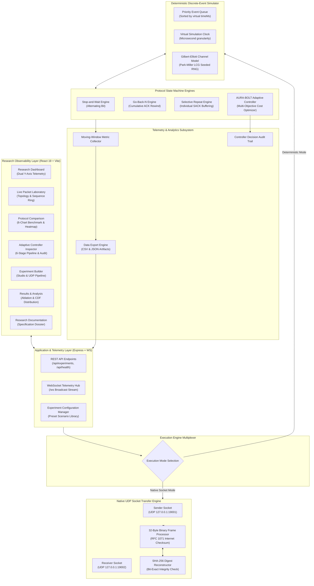
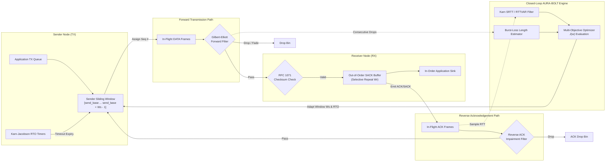
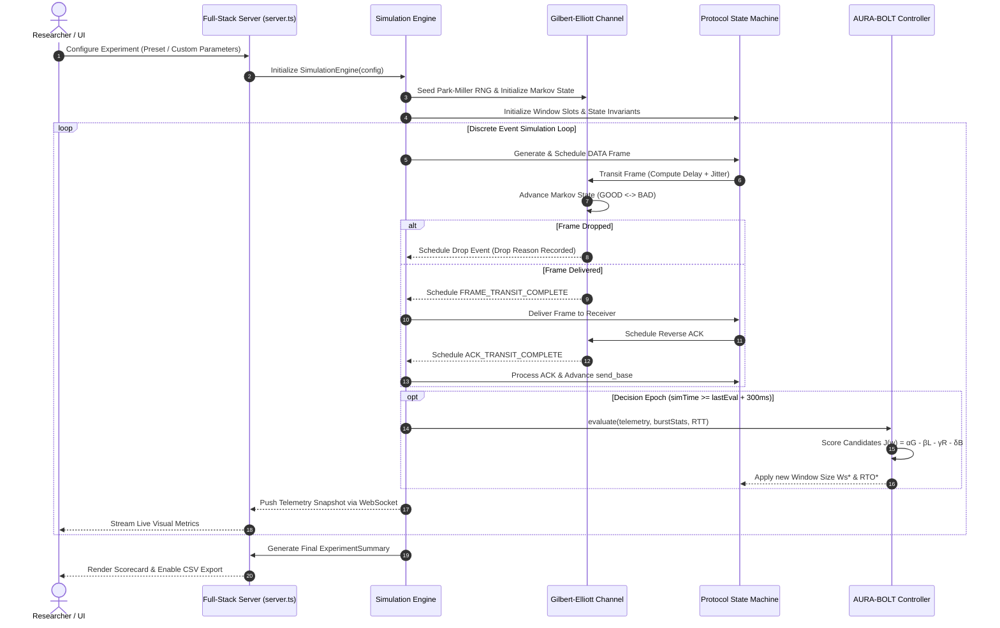

# AURA-BOLT System Architecture Specification

## 1. Architectural Overview & Design Philosophy

**AURA-BOLT** (*Burst-Aware Adaptive ARQ & Sliding Window Optimization Framework*) is designed as an experimental network protocol workstation and research testbed. The system decomposes reliable data transfer research into decoupled layers:

1. **Analytical & Observability User Interface**: Dense, information-rich React/TypeScript workstation featuring time-series telemetry, interactive topological visualization, sliding-window sequence rings, and decision inspectors.
2. **Execution Runtimes (Dual-Engine Architecture)**:
   - **Deterministic Discrete-Event Simulator**: Microsecond-resolution virtual time event scheduler executing across reproducible pseudo-random seeds ($100\%$ determinism guarantee).
   - **Native UDP Socket Engine**: Real kernel-level `dgram` sockets communicating across `127.0.0.1:19001` and `127.0.0.1:19002` with 32-byte binary packet frames, RFC 1071 Internet checksums, and end-to-end SHA-256 integrity verification.
3. **Core Protocol State Machines**: Stop-and-Wait, Go-Back-N, Selective Repeat, and the AURA-BOLT Adaptive Controller.
4. **Physical Channel Impairment Model**: Two-state Gilbert–Elliott Markov chain, Box–Muller Gaussian jitter, asymmetrical forward/reverse loss, and dynamic channel transitions.

---

## 2. High-Level System Architecture Diagram

---

## 3. Component-Level Protocol & Controller Interactions

---

## 4. End-to-End Experiment Lifecycle Sequence

---

## 5. Architectural Subsystems

### 5.1 Presentation Subsystem
The user interface is built on React 19 and compiled via Vite 8. It enforces strict separation of concerns across 7 specialized pages:
- **`Dashboard.tsx`**: High-level real-time telemetry, channel indicators, and multi-zone diagnostics.
- **`PacketLaboratory.tsx`**: Microscopic frame-by-frame inspection, dynamic topology animation, and sequence ring diagram.
- **`ProtocolComparison.tsx`**: Side-by-side empirical benchmarking across identical random seeds.
- **`AdaptiveController.tsx`**: White-box algorithmic debugger exposing candidate score breakdowns and Markov burst transitions.
- **`ExperimentBuilder.tsx`**: Configuration laboratory for parameter sweeps, scenario presets, and real UDP socket control.
- **`ResultsAnalysis.tsx`**: Statistical data analysis, prediction-vs-measurement scatter plots, and confidence interval distributions.
- **`ResearchDocs.tsx`**: In-browser academic specification and formal invariant handbook.

### 5.2 Discrete-Event Simulator Runtime
Implemented in `src/core/simulation/engine.ts`:
- **Event Queue**: Priority queue maintained in ascending `timeMs` order.
- **Deterministic Virtual Clock**: Advanced discontinuously from event timestamp to event timestamp, completely decoupling simulation time from CPU speed.
- **Event Primitives**:
  - `FRAME_TRANSIT_COMPLETE`: Arrival of forward payload at receiver.
  - `ACK_TRANSIT_COMPLETE`: Arrival of reverse acknowledgement at sender.
  - `CHECK_TIMEOUTS`: Evaluates whether $t_{sim} \ge t_{sent} + RTO$.
  - `CONTROLLER_EVALUATE`: Epoch trigger for candidate window scoring.
  - `SAMPLE_METRICS`: Regular interval for rolling time-series snapshots.

### 5.3 Native UDP Socket Runtime
Implemented in `src/core/udpTransfer.ts`:
- Uses Node.js `dgram` module binding to localhost IPv4 addresses.
- Sender creates socket on `127.0.0.1:19001`; Receiver binds to `127.0.0.1:19002`.
- Formats every packet into a strict 32-byte binary header followed by binary payload chunk.
- Implements RFC 1071 16-bit 1's complement Internet checksum calculation and verification.
- Enforces real asynchronous timeout timers via `NodeJS.Timeout`.
- Calculates SHA-256 digests over source buffer and reassembled destination buffer to guarantee bit-exact reliability.

### 5.4 Channel Impairment Subsystem
Implemented in `src/core/simulation/channel.ts`:
- **RNG**: Park-Miller Linear Congruential Generator ($a = 16807, m = 2^{31} - 1$).
- **Markov Chain**: 2-state Gilbert–Elliott model with configurable transition probabilities $P(G \to B)$ and $P(B \to B)$.
- **Delay & Jitter**: Base propagation delay augmented with Gaussian noise via the Box–Muller transform:
  $$Z = \sqrt{-2 \ln U_1} \cos(2\pi U_2)$$
- **Asymmetric Losses**: Distinct forward data loss ($P_{data}$) and reverse ACK loss ($P_{ack}$).
